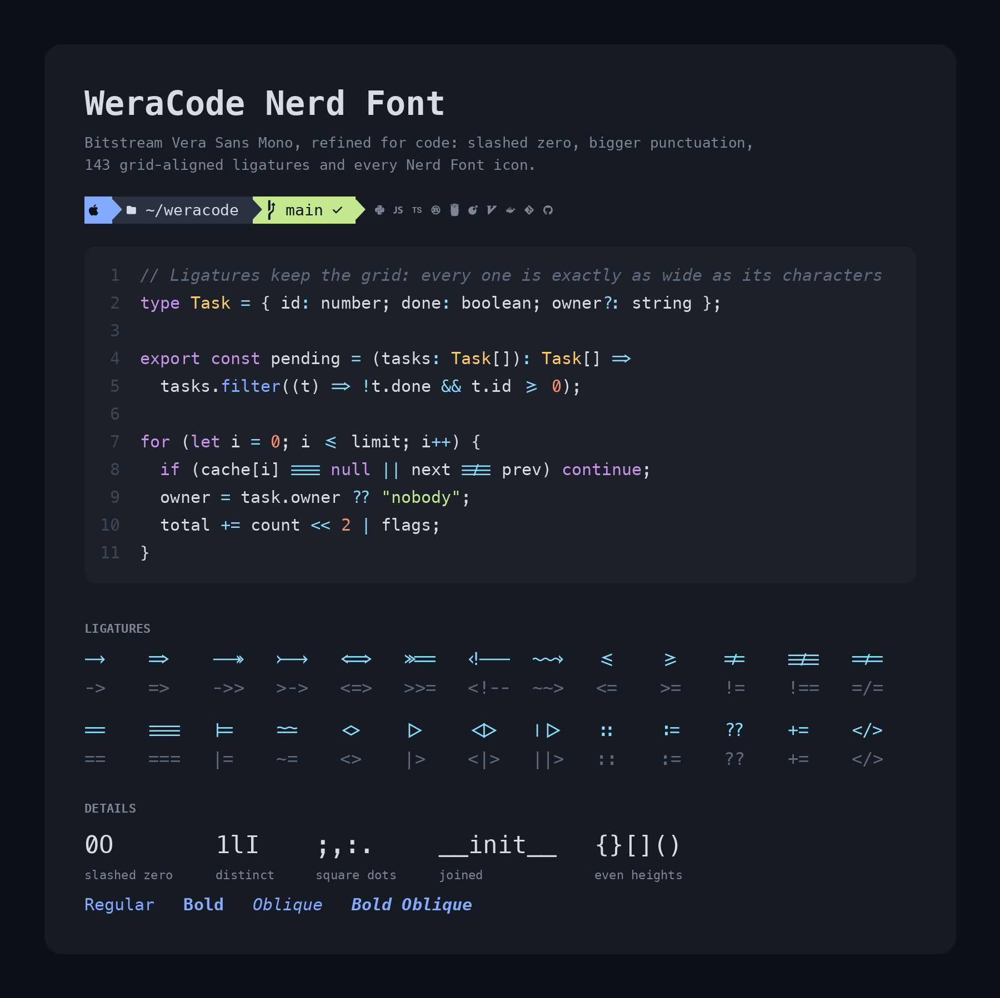

# WeraCode Nerd Font

A customised [Bitstream Vera Sans Mono](https://www.gnome.org/fonts/), built from the
Nerd Fonts v3.4.0 patched version (*BitstromWera Nerd Font*). Every change is derived from
Vera's own outlines; no glyphs are taken from other fonts.



## Changes from Vera

| Glyph | Change |
|---|---|
| `0` | Slashed zero (Vera's is dotted) |
| `_` | Full-width bar overhanging its cell, so `__init__` draws one continuous line |
| `-` (and soft hyphen) | Wider, centred on the `+` bar |
| `–` `—` `~` | Centred on the `+` bar |
| `.` `,` `:` `;` | Dots 25% larger |
| `,` `;` | Square dot with a straight tail slanting down to the left |
| `=` | Bars spaced further apart, on whole pixels at 12px (sharp on non-Retina screens) |
| `*` | 15% larger, lowered toward mid-height |
| `{` `}` | Same height as `( )` and `[ ]` |
| Line height | ~8% taller; box-drawing, block and Powerline glyphs stretched to fill the cell |
| Oblique styles | Italic flag set in `head.macStyle`, so macOS groups them with the family |

All Nerd Font icons are unchanged.

## Ligatures

143 ligatures following [MonoLisa](https://www.monolisa.dev/)'s set, drawn from Vera's own
shapes and measurements (no outlines are taken from MonoLisa):

| Kind | Ligatures |
|---|---|
| Arrows → ⇒ ↦ ↣ | `->` `-->` `--->` `<-` `<--` `<->` `\|->` `->>` `-<<` `>->` `>>-` `<-<` `<<-` `-<` `>-` `=>` `==>` `=>>` `=<<` `>=>` `>>=` `>>>=` `<==` `<=>` `<==>` `<=<` `<<=` `<!--` `<!---` |
| Waves | `~>` `<~` `~~` `~~>` `<~~` `<~>` `-~` `~-` `~~~~` |
| Symbols | `<=` ⩽ · `>=` ⩾ · `!=` ≠ · `!==` · `=/=` · `==` · `===` · `<>` ◇ · `\|=` ⊨ · `\|\|=` · `~=` ≃ · `\|>` ▷ · `<\|` ◁ · `<\|>` · `\|\|>` · `<\|\|` · `\|\|\|>` · `<\|\|\|` |
| Spacing / alignment | `--` `---` `''` `""` `..` `...` `..<` `..=` `.?` `.=` `{\|` `[\|` `\|}` `\|]` `::` `::=` `:=` `:>` `:<` `>:` `<:` `;;` `!!` `!!.` `!!!` `?.` `?:` `??` `?=` `**` `***` `*>` `*/` `/*` `/**` `//` `///` `/=` `/==` `-=` `*=` `+=` `%=` `^=` `&=` `&&` `#:` `#!` `#?` `#=` `#_` `#_(` `####` `######` `########` `$(` `$>` `>&` `<&` `>(` `<(` `++` `+++` `+>` `=:=` `=!=` `>>` `>>>` `<<` `<<<` `<*` `<*>` `<$` `<$>` `<+` `<+>` `%%` `&>` `&>>` `>&-` `<&-` `&^` `&^=` `</` `/>` `</>` `~@` |

- Each ligature takes exactly as many cells as the characters it replaces, so columns and
  cursor movement are unaffected.
- Nothing fires inside a longer run of the same character, so htop meters
  (`[||||||   45%]`), `----` rulers, `#####` and `====` stay plain; `||` is never a ligature.
- `===` and `!==` use three bars (`TRIPLE_EQUAL = "double"` in `build.py` draws one long
  `=` instead); `EQUAL_RUN = 4` joins runs of `=` into one double line.
- In `:=`, `<:` and similar the colon is raised to line up with `=`, `<` and `>`.
- All of them are in the `calt` feature (MonoLisa keeps its symbol ligatures in the optional
  `dlig`, which terminals don't enable): on by default in VS Code
  (`"editor.fontLigatures": true`), JetBrains IDEs, Kitty, WezTerm and Ghostty; iTerm2 needs
  *Use ligatures* enabled in the profile's Text settings. Terminals without ligature support
  show the plain characters.

## Fonts

`fonts/` contains three families, each in Regular, Bold, Oblique and Bold Oblique:

- **WeraCode Nerd Font Mono** – icons forced to one cell; best for terminals and editors
- **WeraCode Nerd Font** – larger icons (~1.5 cells)
- **WeraCode Nerd Font Propo** – proportional icons, for GUI use

On macOS, install by double-clicking the `.ttf` files or copying them to `~/Library/Fonts/`.

## Building

```sh
pip install fonttools skia-pathops
python3 build.py                 # writes fonts/
python3 build.py --line M        # taller line height: S (default), M, L, or vera (original)
python3 build.py --family "Name" # different family name
```

Sizes and positions are constants at the top of `build.py` (`DOT_SCALE`, `EQUAL_SPACING`,
`COMMA_TAIL`, `PIXEL_SNAP`, ...). `source/` holds the unmodified Nerd Font files the build reads.

`python3 showcase.py` redraws `images/showcase.png` from the built fonts (needs Pillow with
libraqm, for ligature shaping).

## License

Modified from Bitstream Vera Sans Mono, Copyright (c) 2003 by Bitstream, Inc., under the
Bitstream Vera Fonts license (see [LICENSE.txt](LICENSE.txt)). As that license requires, the
modified fonts do not use "Bitstream" or "Vera" in their names. Bitstream Vera is a trademark
of Bitstream, Inc.

The icon glyphs were added by [Nerd Fonts](https://github.com/ryanoasis/nerd-fonts) and come
from several icon sets, each under its own license; see the Nerd Fonts
[license information](https://github.com/ryanoasis/nerd-fonts/blob/master/LICENSE) for details.

The ligature set follows [MonoLisa](https://www.monolisa.dev/)'s, but every ligature is drawn
from Vera's own glyphs; no outlines are taken from it.
